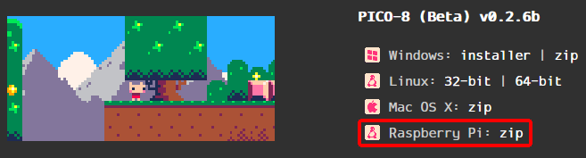

# **Available Emulators**



## Default Emulator

By default MustardOS uses **Picante8**, the MustardOS PICO-8 core, which runs carts through
[Pickles]({{ site.baseurl }}/tour/modules/muxretro). It plays `.p8` and `.p8.png` carts without needing the native
PICO-8 application, and supports:

- Save states, including in multicart games and in carts that run their own game loop.
- Multicart games, where one cart loads another with `load()` or reads its data with `reload()`.
- Cart saves through `cartdata()`, kept in the Pickles save folder.

A game made of several carts, such as Poom, can open as a single item with **Set Launch File**, described in
[Folder Launch Files]({{ site.baseurl }}/installation/launch-files).

FAKE-08 is also available as a libretro core from **Core** in Content Options. Picante8 is only the default because it
does not require you to purchase the native PICO-8 application. We strongly suggest you purchase the native application
to support this wonderful system!

## PICO-8 Emulator Files

Native PICO-8 is supported once you add your own purchased binaries. You will need these files from the
**Raspberry Pi** version:

- pico8_64
- pico8.dat

Place them in `MUOS/bios/pico8` on SD1 or SD2, following where your BIOS files are stored. A `MUOS/bios/pico-8` folder
copied straight from the purchased download is also recognised.

You can also install the official download through Archive Manager. Rename the `pico-8_ver_raspi.zip` file, where
`ver` is the current PICO-8 release, to end in `.muxzip`, copy it to the `ARCHIVE` folder on either card and install it
from **Archive Manager**.

Once the files are in place, switch your PICO-8 content to the standalone emulator:

1. Highlight your PICO-8 folder in Explore Content and press **X** to open Content Options.
2. Choose **Core**, then **PICO-8 - Standalone** or **PICO-8 - Pixel-Perfect - Standalone**.
3. Choose the **Directory** or **Recursive** scope to apply it to every game in the folder.

## PICO-8 Standalone Keys

| Button         | Action            |
|:---------------|:------------------|
| DPAD           | Move              |
| A / R1         | Button X          |
| B / L1         | Button O          |
| Start          | Pause             |
| Select         | Cancel            |
| L2             | Toggle Mouse Mode |
| Left Stick     | Mouse             |
| A (Mouse Mode) | Left Mouse        |
| B (Mouse Mode) | Right Mouse       |
| Start + Select | Quit              |

{: .new}
> Mouse Mode coming soon!

## Where can I get those binaries?

You can purchase PICO-8 from lexaloffle.  
[https://www.lexaloffle.com/pico-8.php](https://www.lexaloffle.com/pico-8.php)

## Can I use Splore?

You sure can!  
You will need to create a blank file named `Splore.p8` [case sensitive] in your PICO-8 ROMs folder.  
You can also download a suitable
file [here](https://raw.githubusercontent.com/MustardOS/mustardos.github.io/refs/heads/main/systems/assets/files/Splore.p8)  
**Simply launch that Splore file from MustardOS and you are in!**
