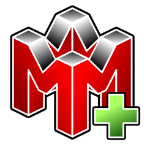

# **Available Emulators**

{: .note }
> The **bolded** entry below is the default core for this system, unless you assign a different one from Content Options.



## Mupen Standalone Keys

| Type                    | Control                  |
|:------------------------|:-------------------------|
| Fast Forward Toggle     | MENU + R1                |
| Load State              | MENU + L2                |
| Save State              | MENU + R2                |
| Save State Cycle        | Menu + DPAD Right        |
| Restart Game            | MENU + A                 |
| Quit Mupen64            | MENU + Start             |
