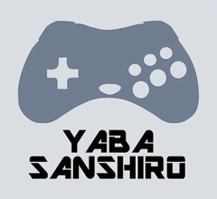

# **Available Emulators**

{: .note }
> The **bolded** entry below is the default core for this system, unless you assign a different one from Content Options.



## Yabadabadoo

Yabadabadoo is the default Sega Saturn core and runs in Pickles. It needs a real Saturn BIOS in `MUOS/bios`, named
`saturn_bios.bin`, `sega_101.bin` (Japan) or `mpr-17933.bin` (USA and Europe). Without one, Pickles stops at launch
and lists the files it needs. It uses the performance governor by default, as Saturn emulation is demanding on these
devices.

## YabaSanshiro Standalone Button Mapping

| Button                  | Action                   |
|:------------------------|:-------------------------|
| SELECT                  | YabaSanshiro Menu        |
| START                   | START                    |
| Y                       | A                        |
| B                       | B                        |
| A                       | C                        |
| X                       | X                        |
| L1                      | Y                        |
| R1                      | Z                        |
| L2                      | L                        |
| R2                      | R                        |

## YabaSanshiro Standalone Compatibility List
[RG ARC Saturn Compatibility List](https://docs.google.com/spreadsheets/d/1GJfdZuFZLvtn6l6K16dvRrBRXopnKWZLqA42QmHhqQU/edit?gid=0#gid=0)  
This list should give a good overview of what can be expected on YabaSanshiro External, compatibility and performance wise.  
The list was compiled for the RG ARC and is also a good guide for the H700 chipset.  

## YabaSanshiro Standalone Bios Files
YabaSanshiro-Ext supports the use of an optional Sega Saturn BIOS file.  
The BIOS file needs to be named 'saturn_bios.bin' and placed in `/MUOS/bios`.  

Using a BIOS *can* improve performance and fix graphical issues in some games.  

***Do note that some games will require a specific region BIOS or will not work with a BIOS at all.***  

If a game boots into a black screen after playing the BIOS animation, try assigning the YabaSanshiro (External - No BIOS) core to it.
