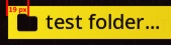

# **Scheme Files**

A scheme is a plain text `.ini` file that sets your theme's colours, transparency, sizes and positions. Each screen
can have its own scheme, and every scheme only needs the settings you want to change.

## Key ideas

    
<code>Colours</code>Six-digit hex codes, such as <code>C69200</code>.

    
<code>Alpha</code>Transparency from <code>0</code>, invisible, to <code>255</code>, fully solid.

    
<code>Missing settings</code>Keep whatever the previous layer set, or the frontend's built-in
        default.

    
<code>One screen</code>Name a scheme after a screen's module, such as <code>muxlaunch.ini</code>, to
        change only that screen. <a href="/themes/structure">Theme Structure</a> lists the module names.

## How schemes are layered

Several schemes can apply to one screen. They load in this order, and a later layer always wins:

    
<strong>Global</strong><code>/scheme/global.ini</code> applies to every screen at every
        resolution.

    
<strong>Resolution default</strong><code>/{resolution}/scheme/default.ini</code> applies to
        every screen at that resolution.

    
<strong>Screen</strong><code>/{resolution}/scheme/{module}.ini</code> applies to one
        screen.

    
<strong>Alternative</strong>The active <a href="/themes/alternative">alternative's</a> scheme
        files.

    
<strong>Device override</strong><code>MUOS/theme/override/{module}.ini</code> on the device
        itself, handy for quick tests without editing the theme.

Layers 2 and 3 look in the resolution folder first, then fall back to the theme's root `scheme` folder. If the theme
has no folder for the device's resolution, MustardOS scales a resolution the theme does support to fit the screen.
Users can also choose a theme resolution themselves in Customisation.

## Jump to a section

    <a href="#section-background">background</a>
    <a href="#section-animation">animation</a>
    <a href="#section-font">font</a>
    <a href="#section-status">status</a>
    <a href="#section-battery">battery</a>
    <a href="#section-network">network</a>
    <a href="#section-bluetooth">bluetooth</a>
    <a href="#section-date">date</a>
    <a href="#section-footer">footer</a>
    <a href="#section-header">header</a>
    <a href="#section-help">help</a>
    <a href="#section-dialogue">dialogue</a>
    <a href="#section-navigation">navigation</a>
    <a href="#section-grid">grid</a>
    <a href="#section-list">list</a>
    <a href="#section-image_list">image_list</a>
    <a href="#section-charging">charging</a>
    <a href="#section-verbose">verbose</a>
    <a href="#section-keyboard">keyboard</a>
    <a href="#section-notification">notification</a>
    <a href="#section-bar">bar</a>
    <a href="#section-roll">roll</a>
    <a href="#section-counter">counter</a>
    <a href="#section-glyph">glyph</a>
    <a href="#section-terminal">terminal</a>
    <a href="#section-sdl">sdl</a>
    <a href="#section-misc">misc</a>

## Setting reference

Each section below matches a `[section]` in a scheme file. Every row shows a setting with an example value, its default and what it does.

### Section [background]

| Setting                          | Default  | Description                                                                                                                          |
|-----------------------------------|----------|--------------------------------------------------------------------------------------------------------------------------------------|
| BACKGROUND=C69200                 | C69200   | Background colour. Most used in [list] gradients.                                                                                    |
| BACKGROUND_ALPHA=255              | 255      | Background colour transparency.                                                                                                      |
| BACKGROUND_GRADIENT_COLOR=C69200  | C69200   | Second colour in the gradient.                                                                                                       |
| BACKGROUND_GRADIENT_START=0       | 0        | Start point of gradient change. [BACKGROUND] changes to [BACKGROUND_GRADIENT_COLOR] colour.                                          |
| BACKGROUND_GRADIENT_STOP=200      | 200      | End point of gradient change.                                                                                                        |
| BACKGROUND_GRADIENT_DIRECTION=0   | 0        | Direction of gradient.  0 = None 1 = Vertical 2 = Horizontal                                                                |
| BACKGROUND_GRADIENT_DITHER=0      | 0        | Apply dithering effect to background gradient to help smooth out banding in the background gradient.  0 = Disabled 1 = Enabled |
| BACKGROUND_GRADIENT_BLUR=0        | 0        | Apply blur to background gradient.  0 = Disabled 1 or greater = Level of blur.                                                 |

### Section [animation]

{: .note }
> These settings are parsed and stored by the frontend. Nothing currently reads them to drive visible behaviour;
> list item animation timing is hard coded elsewhere. They are documented for completeness and currently have no
> visible effect.

| Setting                     | Default | Description                                    |
|------------------------------|---------|-------------------------------------------------|
| ANIMATION_DELAY=100          | 100     | Reserved. Minimum accepted value is 10.          |
| ANIMATION_REPEAT=0           | 0       | Reserved.                                        |
| ANIMATION_FOREGROUND=0       | 0       | Reserved.                                        |
| ANIMATION_POSITION=4         | 4       | Reserved.                                        |
| ANIMATION_ALPHA=255          | 255     | Reserved. Accepted range is 1-255.               |

### Section [font]

Font *sizes* set here are the theme's own preference, in pixels. A user can still override any of these from their
own device in Customisation > Font Settings, which always takes priority over what the theme sets here. See the
[Custom Fonts]({{site.baseurl}}/themes/fonts) page for how to actually supply the font files these sizes apply to.

| Setting                        | Default | Description                                                                                  |
|--------------------------------|---------|------------------------------------------------------------------------------------------------|
| FONT_LIST_SIZE=0               | 0 (auto)| Point size for list item text. `0` leaves it at the frontend's device-appropriate default.     |
| FONT_HEADER_SIZE=0             | 0 (auto)| Point size for header text. `0` leaves it at the frontend's device-appropriate default.         |
| FONT_FOOTER_SIZE=0             | 0 (auto)| Point size for footer text. `0` leaves it at the frontend's device-appropriate default.         |
| FONT_PANEL_SIZE=0              | 0 (auto)| Point size for grid mode panel text. `0` leaves it at the frontend's device-appropriate default.|
| FONT_HEADER_PAD_TOP=0          | 0       | Number of pixels from top of header area to header text.            |
| FONT_HEADER_PAD_BOTTOM=0       | 0       | Number of pixels from bottom of header area to header text.         |
| FONT_HEADER_ICON_PAD_TOP=0     | 0       | Number of pixels from top of header area to header icons.           |
| FONT_HEADER_ICON_PAD_BOTTOM=0  | 0       | Number of pixels from bottom of header area to header icons.        |
| FONT_FOOTER_PAD_TOP=0          | 0       | Number of pixels from top of footer area to footer text.            |
| FONT_FOOTER_PAD_BOTTOM=0       | 0       | Number of pixels from bottom of footer area to footer text.         |
| FONT_FOOTER_ICON_PAD_TOP=0     | 0       | Number of pixels from top of footer area to footer icons.           |
| FONT_FOOTER_ICON_PAD_BOTTOM=0  | 0       | Number of pixels from bottom of footer area to footer icons.        |
| FONT_MESSAGE_PAD_TOP=0         | 0       | Number of pixels from top of message area to message text.          |
| FONT_MESSAGE_PAD_BOTTOM=0      | 0       | Number of pixels from bottom of message area to message text.       |
| FONT_MESSAGE_ICON_PAD_TOP=0    | 0       | Number of pixels from top of message area to message icons.         |
| FONT_MESSAGE_ICON_PAD_BOTTOM=0 | 0       | Number of pixels from bottom of message area to message icons.      |
| FONT_LIST_PAD_TOP=0            | 0       | Number of pixels from top of a list item area to a list item text.  |
| FONT_LIST_PAD_BOTTOM=0         | 0       | Number of pixels from bottom of an item area to a list item text.   |
| FONT_LIST_PAD_LEFT=32          | 32      | Number of pixels from left of a list item area to a list item text. |
| FONT_LIST_PAD_RIGHT=6          | 6       | Number of pixels from right of an item area to a list item text.    |
| FONT_LIST_ICON_PAD_TOP=0       | 0       | Number of pixels from top of a list item area to a list item glyph. |
| FONT_LIST_ICON_PAD_BOTTOM=0    | 0       | Number of pixels from bottom of an item area to a list item glyph.  |

**Note:** By default text and glyphs in the header, footer, and list items will be centred vertically. It is
recommended to start with a value of 0. Depending on the font used you may need to adjust the FONT_LIST_PAD_TOP or
FONT_LIST_PAD_BOTTOM settings. FONT_LIST_PAD_TOP to move the text down and FONT_LIST_PAD_BOTTOM to move the text up. Do
not use both settings at the same time.

### Section [status]

| Setting         | Description                                                                                                                                                                                                                                                      |
|-----------------|------------------------------------------------------------------------------------------------------------------------------------------------------------------------------------------------------------------------------------------------------------------|
| ALIGN=1         | Alignment of header icons 0 = Left 1 = Right 2 = Centre 3 = Icons spaced evenly across header 4 = icons evenly distributed with equal space around them 5 = First icon aligned left last icon aligned right all other icons evenly distributed |
| PADDING_LEFT=0  | Number of pixels of space to add to left side of the header icons.                                                                                                                                                                                               |
| PADDING_RIGHT=0 | Number of pixels of space to add to right side of the header icons.                                                                                                                                                                                               |

### Section [battery]

| Setting                  | Description                                   |
|--------------------------|-----------------------------------------------|
| BATTERY_NORMAL=FFFFFF    | Battery icon standard recolour.               |
| BATTERY_ACTIVE=85F718    | On-charge battery icon recolour.              |
| BATTERY_LOW=D35C54       | Low battery icon recolour.                    |
| BATTERY_NORMAL_ALPHA=255 | Battery icon standard recolour transparency.  |
| BATTERY_ACTIVE_ALPHA=255 | On-charge battery icon recolour transparency. |
| BATTERY_LOW_ALPHA=255    | Low battery icon recolour transparency.       |

### Section [network]

| Setting                  | Description                                      |
|--------------------------|---------------------------------------------------|
| NETWORK_NORMAL=282525    | Disconnected network icon recolour.               |
| NETWORK_ACTIVE=F7E318    | Connected network icon recolour.                  |
| NETWORK_NORMAL_ALPHA=255 | Disconnected network icon recolour transparency.  |
| NETWORK_ACTIVE_ALPHA=255 | Connected network icon recolour transparency.     |

### Section [bluetooth]

| Setting                    | Description                                         |
|----------------------------|------------------------------------------------------|
| BLUETOOTH_NORMAL=282525    | Disconnected bluetooth icon recolour.                |
| BLUETOOTH_ACTIVE=F7E318    | Connected bluetooth icon recolour.                   |
| BLUETOOTH_NORMAL_ALPHA=255 | Disconnected bluetooth icon recolour transparency.   |
| BLUETOOTH_ACTIVE_ALPHA=255 | Connected bluetooth icon recolour transparency.      |

### Section [date]

| Setting              | Description                                                               |
|----------------------|---------------------------------------------------------------------------|
| DATETIME_TEXT=FFFFFF | Time text colour.                                                         |
| DATETIME_ALPHA=255   | Time text transparency.                                                   |
| DATETIME_ALIGN=1     | Alignment of time text 0 = Auto 1 = Left 2 = Centre 3 = Right |
| PADDING_LEFT=0       | Number of pixels of space to add to left side of the time text.           |
| PADDING_RIGHT=0      | Number of pixels of space to add to right side of the time text.          |

### Section [footer]

| Setting                   | Description                                                     |
|---------------------------|-----------------------------------------------------------------|
| FOOTER_HEIGHT=42          | Adjust the height of the footer by pixels.                      |
| FOOTER_BACKGROUND=100808  | Footer area/background colour.                                  |
| FOOTER_BACKGROUND_ALPHA=255 | Footer area/background transparency.                           |
| FOOTER_TEXT=FFFFFF        | Footer text colour, not including any navigation buttons.       |
| FOOTER_TEXT_ALPHA=255     | Footer text transparency, not including any navigation buttons. |

### Section [header]

| Setting                   | Description                                                                       |
|---------------------------|-----------------------------------------------------------------------------------|
| HEADER_HEIGHT=42          | Adjust the height of the header by pixels.                                        |
| HEADER_BACKGROUND=100808  | Header area/background colour.                                                    |
| HEADER_BACKGROUND_ALPHA=255 | Header area/background transparency.                                            |
| HEADER_TEXT=FFFFFF        | Header text colour, not including time text.                                      |
| HEADER_TEXT_ALPHA=255     | Header text transparency, not including time text.                                |
| HEADER_TEXT_ALIGN=2       | Alignment of header title text 0 = Auto 1 = Left 2 = Centre 3 = Right |
| PADDING_LEFT=0            | Number of pixels of space to add to left side of the title text.                  |
| PADDING_RIGHT=0           | Number of pixels of space to add to right side of the title text.                 |

### Section [help]

| Setting                   | Description                                              |
|---------------------------|------------------------------------------------------------|
| HELP_BACKGROUND=282525    | Help/info background window colour.                      |
| HELP_BACKGROUND_ALPHA=255 | Help/info background window transparency.                |
| HELP_BORDER=100808        | Help/info window border colour.                           |
| HELP_BORDER_ALPHA=255     | Help/info window border transparency.                     |
| HELP_CONTENT=A5B2B5       | Help/info window standard text colour.                    |
| HELP_TITLE=F7E318         | Help/info window title text colour.                       |
| HELP_RADIUS=3             | Border roundness. 0 is a right angle. 10+ is very round.  |

### Section [dialogue]

Covers confirmation prompts and popup dialogues, such as the save-scope prompt shown when backing out of a
settings screen with unsaved changes.

| Setting                              | Default | Description                                                                     |
|----------------------------------------|---------|----------------------------------------------------------------------------------|
| DIALOGUE_BACKGROUND=282525             | 282525  | Dialogue window background colour.                                              |
| DIALOGUE_BACKGROUND_ALPHA=255          | 255     | Dialogue window background transparency.                                        |
| DIALOGUE_BORDER=100808                 | 100808  | Dialogue window border colour.                                                  |
| DIALOGUE_BORDER_ALPHA=255              | 255     | Dialogue window border transparency.                                            |
| DIALOGUE_TITLE=F7E318                  | F7E318  | Dialogue title text colour.                                                     |
| DIALOGUE_CONTENT=A5B2B5                | A5B2B5  | Dialogue body text colour.                                                      |
| DIALOGUE_OPTION=282525                 | 282525  | Colour of the individual selectable options within the dialogue.                |
| DIALOGUE_DIM_ALPHA=128                 | 128     | How much the rest of the screen dims behind an open dialogue.                   |
| DIALOGUE_SELECTION=F7E318              | F7E318  | Colour of the currently highlighted option.                                     |
| DIALOGUE_SELECTION_ALPHA=255           | 255     | Transparency of the currently highlighted option's colour.                      |
| DIALOGUE_RADIUS_MAIN=3                 | 3       | Dialogue window corner radius. 0 is a right angle, 10+ is very round.           |
| DIALOGUE_RADIUS_SELECTED=0             | 0       | Corner radius of the highlighted option.                                        |
| DIALOGUE_SHADOW_COLOUR=000000          | 000000  | Drop shadow colour cast by the dialogue window.                                 |
| DIALOGUE_SHADOW_ALPHA=255              | 255     | Drop shadow transparency. Accepted range is 1-255.                              |
| DIALOGUE_SHADOW_X_OFFSET=2             | 2       | Horizontal offset of the drop shadow, in pixels.                                |
| DIALOGUE_SHADOW_Y_OFFSET=2             | 2       | Vertical offset of the drop shadow, in pixels.                                  |
| DIALOGUE_SHADOW_COLOUR_FOCUS=222222    | 222222  | Drop shadow colour for the highlighted option.                                  |
| DIALOGUE_SHADOW_ALPHA_FOCUS=96         | 96      | Drop shadow transparency for the highlighted option. Accepted range is 1-255.   |
| DIALOGUE_SHADOW_X_OFFSET_FOCUS=2       | 2       | Horizontal drop shadow offset for the highlighted option, in pixels.            |
| DIALOGUE_SHADOW_Y_OFFSET_FOCUS=2       | 2       | Vertical drop shadow offset for the highlighted option, in pixels.              |

### Section [navigation]

| Setting                           | Description                                                                                                                                          |
|-----------------------------------|-----------------------------------------------------------------------------------------------------------------------------------------------------|
| ALIGNMENT=1                       | Regarding all navigation buttons in the footer. 0 = aligned to the left, 1 = central aligned, 2 = aligned to the right. Anything above is a secret. |
| SPACING=0                         | Amount of spacing, in pixels, between each navigation hint in the footer.                                                                            |
| NAV_LR_GLYPH=F7E318               | The device's "L/R" shoulder button hint icon recolour.                                                                                                |
| NAV_LR_GLYPH_ALPHA=255            | The device's "L/R" hint icon transparency.                                                                                                            |
| NAV_LR_GLYPH_RECOLOUR_ALPHA=255   | The device's "L/R" hint icon recolour transparency.                                                                                                   |
| NAV_LR_TEXT=FFFFFF                | Text describing the function of "L/R" - recolour.                                                                                                     |
| NAV_LR_TEXT_ALPHA=255             | Text describing the function of "L/R" - transparency.                                                                                                 |
| NAV_UD_GLYPH=F7E318               | The device's "Up/Down" hint icon recolour.                                                                                                             |
| NAV_UD_GLYPH_ALPHA=255            | The device's "Up/Down" hint icon transparency.                                                                                                        |
| NAV_UD_GLYPH_RECOLOUR_ALPHA=255   | The device's "Up/Down" hint icon recolour transparency.                                                                                               |
| NAV_UD_TEXT=FFFFFF                | Text describing the function of "Up/Down" - recolour.                                                                                                 |
| NAV_UD_TEXT_ALPHA=255             | Text describing the function of "Up/Down" - transparency.                                                                                             |
| NAV_A_GLYPH=000000                | The device's "A" button - icon recolour .                                                                                                           |
| NAV_A_GLYPH_ALPHA=255             | The device's "A" button - icon transparency.                                                                                                        |
| NAV_A_GLYPH_RECOLOUR_ALPHA=255    | The device's "A" button - icon recolour transparency.                                                                                               |
| NAV_A_TEXT=000000                 | Text describing the function of the "A" button - recolour .                                                                                         |
| NAV_A_TEXT_ALPHA=255              | Text describing the function of the "A" button - transparency.                                                                                      |
| NAV_B_GLYPH=000000                | The device's "B" button - icon colour.                                                                                                              |
| NAV_B_GLYPH_ALPHA=255             | The device's "B" button - icon transparency.                                                                                                        |
| NAV_B_GLYPH_RECOLOUR_ALPHA=255    | The device's "B" button - icon recolour transparency.                                                                                               |
| NAV_B_TEXT=000000                 | Text describing the function of the "B" button - recolour .                                                                                         |
| NAV_B_TEXT_ALPHA=255              | Text describing the function of the "B" button - transparency.                                                                                      |
| NAV_C_GLYPH=000000                | The device's "C" button - icon colour.                                                                                                              |
| NAV_C_GLYPH_ALPHA=255             | The device's "C" button - icon transparency.                                                                                                        |
| NAV_C_GLYPH_RECOLOUR_ALPHA=255    | The device's "C" button - icon recolour transparency.                                                                                               |
| NAV_C_TEXT=000000                 | Text describing the function of the "C" button - recolour .                                                                                         |
| NAV_C_TEXT_ALPHA=255              | Text describing the function of the "C" button - transparency.                                                                                      |
| NAV_X_GLYPH=000000                | The device's "X" button - icon colour.                                                                                                              |
| NAV_X_GLYPH_ALPHA=255             | The device's "X" button - icon transparency.                                                                                                        |
| NAV_X_GLYPH_RECOLOUR_ALPHA=255    | The device's "X" button - icon recolour transparency.                                                                                               |
| NAV_X_TEXT=000000                 | Text describing the function of the "X" button - recolour .                                                                                         |
| NAV_X_TEXT_ALPHA=255              | Text describing the function of the "X" button - transparency.                                                                                      |
| NAV_Y_GLYPH=000000                | The device's "Y" button - icon colour.                                                                                                              |
| NAV_Y_GLYPH_ALPHA=255             | The device's "Y" button - icon transparency.                                                                                                        |
| NAV_Y_GLYPH_RECOLOUR_ALPHA=255    | The device's "Y" button - icon recolour transparency.                                                                                               |
| NAV_Y_TEXT=000000                 | Text describing the function of the "Y" button - recolour .                                                                                         |
| NAV_Y_TEXT_ALPHA=255              | Text describing the function of the "Y" button - transparency.                                                                                      |
| NAV_Z_GLYPH=000000                | The device's "Z" button - icon colour.                                                                                                              |
| NAV_Z_GLYPH_ALPHA=255             | The device's "Z" button - icon transparency.                                                                                                        |
| NAV_Z_GLYPH_RECOLOUR_ALPHA=255    | The device's "Z" button - icon recolour transparency.                                                                                               |
| NAV_Z_TEXT=000000                 | Text describing the function of the "Z" button - recolour .                                                                                         |
| NAV_Z_TEXT_ALPHA=255              | Text describing the function of the "Z" button - transparency.                                                                                      |
| NAV_MENU_GLYPH=000000             | The device's "M/MENU" button - icon colour.                                                                                                         |
| NAV_MENU_GLYPH_ALPHA=255          | The device's "M/MENU" button - icon transparency.                                                                                                   |
| NAV_MENU_GLYPH_RECOLOUR_ALPHA=255 | The device's "M/MENU" button - icon recolour transparency.                                                                                          |
| NAV_MENU_TEXT=000000              | Text describing the function of the "M" button - recolour .                                                                                         |
| NAV_MENU_TEXT_ALPHA=255           | Text describing the function of the "M" button - transparency.                                                                                      |

### Section [grid]

Allows for displaying a grid of icons for the main menu or content explorer. Content Explorer will only be displayed for
directories that only contain folders. You can disable grid view for a specific folder by adding an empty `.nogrid` text
file to the root of the directory.

| Setting                                       | Description                                                                                                                                                                              |
|-----------------------------------------------|------------------------------------------------------------------------------------------------------------------------------------------------------------------------------------------|
| ALIGNMENT=0                                   | Overall alignment of the grid within the screen.                                                                                                                                         |
| ALIGNMENT_X_OFFSET=0                          | Horizontal offset applied on top of ALIGNMENT, in pixels.                                                                                                                                |
| ALIGNMENT_Y_OFFSET=0                          | Vertical offset applied on top of ALIGNMENT, in pixels.                                                                                                                                  |
| CURRENT_ITEM_LABEL_ALIGNMENT=9                | Label alignment: 1=Top Left 2=Top Middle 3=Top Right 4=Bottom Left 5=Bottom Middle 6=Bottom Right 7=Left Middle 8=Right Middle 9=Centre                       |
| CURRENT_ITEM_LABEL_WIDTH=600                  | Width of label. A value of 0 will size to content.                                                                                                                                       |
| CURRENT_ITEM_LABEL_HEIGHT=0                   | Height of label. A value of 0 will size to content.                                                                                                                                      |
| CURRENT_ITEM_LABEL_OFFSET_X=0                 | Horizontal offset based on CURRENT_ITEM_LABEL_ALIGNMENT.                                                                                                                                 |
| CURRENT_ITEM_LABEL_OFFSET_Y=260               | Vertical offset based on CURRENT_ITEM_LABEL_ALIGNMENT.                                                                                                                                   |
| CURRENT_ITEM_LABEL_RADIUS=10                  | Add radius to label corners. 0 is a right angle. 10+ is very round.                                                                                                                      |
| CURRENT_ITEM_LABEL_BORDER_WIDTH=5             | Border width in pixels.                                                                                                                                                                  |
| CURRENT_ITEM_LABEL_BORDER=FFFFFF              | Label border colour.                                                                                                                                                                     |
| CURRENT_ITEM_LABEL_BORDER_ALPHA=0             | Label border transparency.                                                                                                                                                               |
| CURRENT_ITEM_LABEL_BACKGROUND=F7E318          | Label background colour.                                                                                                                                                                 |
| CURRENT_ITEM_LABEL_BACKGROUND_ALPHA=0         | Label background transparency.                                                                                                                                                           |
| CURRENT_ITEM_LABEL_BACKGROUND_GRADIENT_COLOR=F7E318 | Second colour in the label's background gradient.                                                                                                                                  |
| CURRENT_ITEM_LABEL_BACKGROUND_GRADIENT_START=255 | Start point of the label's gradient change.                                                                                                                                           |
| CURRENT_ITEM_LABEL_BACKGROUND_GRADIENT_STOP=255  | End point of the label's gradient change.                                                                                                                                             |
| CURRENT_ITEM_LABEL_BACKGROUND_GRADIENT_DIRECTION=0 | Direction of the label's gradient.  0 = None 1 = Vertical 2 = Horizontal                                                                                                 |
| CURRENT_ITEM_LABEL_TEXT=100808                | Label text colour.                                                                                                                                                                       |
| CURRENT_ITEM_LABEL_TEXT_ALPHA=0               | Label text transparency.                                                                                                                                                                 |
| CURRENT_ITEM_LABEL_TEXT_ALIGNMENT=2           | Text horizontal alignment: 1=Left 2=Centre 3=Right                                                                                                                              |
| CURRENT_ITEM_LABEL_TEXT_LINE_SPACING=0        | Amount of spacing between lines of text.  Negative values can be used.                                                                                                                   |
| CURRENT_ITEM_LABEL_LABEL_LONG_MODE=0          | Long text mode for the label.  0 = Wrap long lines 1 = Show ellipsis when unselected, scroll when selected                                                                        |
| CURRENT_ITEM_LABEL_TEXT_PADDING_BOTTOM=10     | Amount of padding between bottom edge of label and text.                                                                                                                                 |
| CURRENT_ITEM_LABEL_TEXT_PADDING_LEFT=10       | Amount of padding between left edge of label and text.                                                                                                                                   |
| CURRENT_ITEM_LABEL_TEXT_PADDING_RIGHT=10      | Amount of padding between right edge of label and text.                                                                                                                                  |
| CURRENT_ITEM_LABEL_TEXT_PADDING_TOP=10        | Amount of padding between top edge of label and text.                                                                                                                                    |
| CURRENT_ITEM_LABEL_SHADOW=000000              | Label drop shadow colour.                                                                                                                                                                |
| CURRENT_ITEM_LABEL_SHADOW_WIDTH=0             | Label drop shadow blur width in pixels.                                                                                                                                                  |
| CURRENT_ITEM_LABEL_SHADOW_X_OFFSET=10         | Label drop shadow horizontal offset in pixels.                                                                                                                                           |
| CURRENT_ITEM_LABEL_SHADOW_Y_OFFSET=10         | Label drop shadow vertical offset in pixels.                                                                                                                                             |
| NAVIGATION_TYPE=2                             | 2: Left/right/up/down navigation. Left/Right navigation at beginning or end of row moves to previous or next row. 4: Same as 2 except that left/right wraps around on the active row. |
| BACKGROUND=000000                             | Grid main background colour.                                                                                                                                                             |
| BACKGROUND_ALPHA=0                            | Grid main background transparency.                                                                                                                                                       |
| LOCATION_X=0                                  | Horizontal position of grid in pixels                                                                                                                                                    |
| LOCATION_Y=0                                  | Vertical position of grid in pixels                                                                                                                                                      |
| COLUMN_COUNT=0                                | Number of columns                                                                                                                                                                        |
| COLUMN_PADDING=0                              | Space, in pixels, between each column.                                                                                                                                                   |
| ROW_COUNT=0                                   | Number of rows displayed on screen at one time                                                                                                                                           |
| ROW_HEIGHT=0                                  | Height in pixels of each row                                                                                                                                                             |
| ROW_PADDING=0                                 | Space, in pixels, between each row.                                                                                                                                                       |
| COLUMN_WIDTH=0                                | Width in pixels of each column                                                                                                                                                           |
| CELL_COLUMN_ALIGN=1                           | Alignment of grid cell to column.  0 = Left 1 = Centre 2 = Right                                                                                                                |
| CELL_ROW_ALIGN=1                              | Alignment of grid cell to row.  0 = Top 1 = Centre 2 = Bottom                                                                                                                   |
| CELL_WIDTH=200                                | Width of cell in pixels.  Cell will be centred horizontally and vertically.                                                                                                             |
| CELL_HEIGHT=200                               | Height of cell in pixels.  Cell will be centred horizontally and vertically.                                                                                                            |
| CELL_RADIUS=10                                | Add radius to cell corners. 0 is a right angle. 10+ is very round.                                                                                                                       |
| CELL_BORDER_WIDTH=5                           | Cell border width in pixels.                                                                                                                                                             |
| CELL_IMAGE_PADDING_TOP=5                      | Amount of padding between top edge of cell and cell image.  **Note:** If text alpha is set to 0 image will be centred in the cell by default.                                           |
| CELL_TEXT_PADDING_BOTTOM=5                    | Amount of padding between bottom edge of cell and text label.                                                                                                                            |
| CELL_TEXT_PADDING_SIDE=5                      | Amount of padding between edge of cell and text label.                                                                                                                                   |
| CELL_TEXT_LINE_SPACING=0                      | Adjust spacing between lines for text labels that wrap text.  Negative values can be used to bring lines closer together.                                                                |
| CELL_SHADOW=000000                            | Grid cell shadow colour                                                                                                                                                                  |
| CELL_SHADOW_WIDTH=0                           | Width in pixels of the shadow                                                                                                                                                            |
| CELL_SHADOW_X_OFFSET=10                       | Horizontal offset in pixels of the shadow                                                                                                                                                |
| CELL_SHADOW_Y_OFFSET=10                       | Vertical offset in pixels of the shadow                                                                                                                                                  |
| CELL_DEFAULT_BACKGROUND=000000                | Unselected cell background colour.                                                                                                                                                       |
| CELL_DEFAULT_BACKGROUND_ALPHA=255             | Unselected cell background transparency.                                                                                                                                                 |
| CELL_DEFAULT_BACKGROUND_GRADIENT_COLOR=000000 | Second colour in the gradient.                                                                                                                                                           |
| CELL_DEFAULT_BACKGROUND_GRADIENT_START=0      | Start point of gradient change. [CELL_DEFAULT_BACKGROUND] changes to [CELL_DEFAULT_BACKGROUND_GRADIENT_COLOR] colour.                                                                    |
| CELL_DEFAULT_BACKGROUND_GRADIENT_STOP=255     | End point of gradient change.                                                                                                                                                            |
| CELL_DEFAULT_BACKGROUND_GRADIENT_DIRECTION=0  | Direction of gradient.  0 = None 1 = Vertical 2 = Horizontal                                                                                                                    |
| CELL_DEFAULT_BORDER=000000                    | Unselected cell border colour.                                                                                                                                                           |
| CELL_DEFAULT_BORDER_ALPHA=255                 | Unselected cell border transparency.                                                                                                                                                     |
| CELL_DEFAULT_IMAGE_ALPHA=255                  | Unselected cell image transparency.                                                                                                                                                      |
| CELL_DEFAULT_IMAGE_RECOLOUR=000000            | Unselected cell image recolour.                                                                                                                                                          |
| CELL_DEFAULT_IMAGE_RECOLOUR_ALPHA=0           | Unselected cell image recolour transparency.                                                                                                                                             |
| CELL_DEFAULT_TEXT=000000                      | Unselected cell text colour.                                                                                                                                                             |
| CELL_DEFAULT_TEXT_ALPHA=255                   | Unselected cell text transparency.                                                                                                                                                       |
| CELL_FOCUS_BACKGROUND=000000                  | Selected cell background colour.                                                                                                                                                         |
| CELL_FOCUS_BACKGROUND_ALPHA=255               | Selected cell background transparency.                                                                                                                                                   |
| CELL_FOCUS_BACKGROUND_GRADIENT_COLOR=000000   | Second colour in the gradient.                                                                                                                                                           |
| CELL_FOCUS_BACKGROUND_GRADIENT_START=0        | Start point of gradient change. [CELL_FOCUS_BACKGROUND] changes to [CELL_FOCUS_BACKGROUND_GRADIENT_COLOR] colour.                                                                        |
| CELL_FOCUS_BACKGROUND_GRADIENT_STOP=255       | End point of gradient change.                                                                                                                                                            |
| CELL_FOCUS_BACKGROUND_GRADIENT_DIRECTION=0    | Direction of gradient.  0 = None 1 = Vertical 2 = Horizontal                                                                                                                    |
| CELL_FOCUS_BORDER=000000                      | Selected cell border colour.                                                                                                                                                             |
| CELL_FOCUS_BORDER_ALPHA=255                   | Selected cell border transparency.                                                                                                                                                       |
| CELL_FOCUS_IMAGE_ALPHA=255                    | Selected cell image transparency.                                                                                                                                                        |
| CELL_FOCUS_IMAGE_RECOLOUR=000000              | Selected cell image recolour.                                                                                                                                                            |
| CELL_FOCUS_IMAGE_RECOLOUR_ALPHA=0             | Selected cell image recolour transparency.                                                                                                                                               |
| CELL_FOCUS_TEXT=000000                        | Selected cell text colour.                                                                                                                                                               |
| CELL_FOCUS_TEXT_ALPHA=255                     | Selected cell text transparency.                                                                                                                                                         |

### Section [list]

For all list item backgrounds, gradients can be applied. L-R = 0-255.

| Setting                               | Description                                                                                                                                                                                                                                       |
|---------------------------------------|-----------------------------------------------------------------------------------------------------------------------------------------------------------------------------------------------------------------------------------------------------|
| LIST_DEFAULT_RADIUS=0                 | Background window border radius. 0 = square, 5+ = round. This applies setting applies to LIST_DEFAULT_BACKGROUND & LIST_FOCUS_BACKGROUND                                                                                                          |
| LIST_DEFAULT_BACKGROUND=ececec        | Unselected list item main background colour.                                                                                                                                                                                                      |
| LIST_DEFAULT_BACKGROUND_ALPHA=0       | Unselected list item main background transparency.                                                                                                                                                                                                |
| LIST_DEFAULT_GRADIENT_START=0         | Start point of the change towards the second background colour.                                                                                                                                                                                   |
| LIST_DEFAULT_GRADIENT_STOP=0          | End point of gradient change.                                                                                                                                                                                                                     |
| LIST_DEFAULT_GRADIENT_DIRECTION=0     | Direction of gradient.  0 = None 1 = Vertical 2 = Horizontal                                                                                                                                                                             |
| LIST_DEFAULT_BORDER_WIDTH=5           | Unselected list item border width in pixels.                                                                                                                                                                                                      |
| LIST_DEFAULT_BORDER_SIDE=4            | Unselected list item border sides. 0 = None 1 = Bottom 2 = Top 4 = Left 8 = Right **Note:** To do multiple sides add the values.  For example to do top, bottom, left, and right you would add the 4 values together to get 15. |
| LIST_DEFAULT_INDICATOR=ececec         | Unselected list item indicator/border colour.                                                                                                                                                                                                     |
| LIST_DEFAULT_INDICATOR_ALPHA=0        | Unselected list item indicator/border transparency.                                                                                                                                                                                               |
| LIST_DEFAULT_TEXT=53422e              | Unselected list item text colour.                                                                                                                                                                                                                 |
| LIST_DEFAULT_TEXT_ALPHA=255           | Unselected list item text transparency.                                                                                                                                                                                                           |
| LIST_DEFAULT_GLYPH_PAD_LEFT=19        | Adjusts the padding in pixels from the left side of the list item to the centre of the glyph.                                                                                             |
| LIST_DEFAULT_GLYPH_PAD_RIGHT=6        | Adjusts the padding in pixels from the right side of the list item to the centre of the glyph.                                                                                                                                                   |
| LIST_DEFAULT_GLYPH_ALPHA=255          | List item glyph transparency                                                                                                                                                                                                                      |
| LIST_DEFAULT_GLYPH_RECOLOUR=53422e    | Unselected list item glyph recolour.                                                                                                                                                                                                              |
| LIST_DEFAULT_GLYPH_RECOLOUR_ALPHA=255 | Transparency of this colour.                                                                                                                                                                                                                      |
| LIST_DEFAULT_LABEL_LONG_MODE=1        | Long mode behaviour for label text.  0 = Wrap long lines 1 = Show an ellipsis when unselected and scroll text when selected.                                                                                                                 |
| LIST_DEFAULT_SHADOW_COLOUR=000000     | Unselected list item drop shadow colour.                                                                                                                                                                                                          |
| LIST_DEFAULT_SHADOW_ALPHA=255         | Unselected list item drop shadow transparency. Accepted range is 1-255.                                                                                                                                                                            |
| LIST_DEFAULT_SHADOW_X_OFFSET=2        | Unselected list item drop shadow horizontal offset in pixels.                                                                                                                                                                                     |
| LIST_DEFAULT_SHADOW_Y_OFFSET=2        | Unselected list item drop shadow vertical offset in pixels.                                                                                                                                                                                       |
| LIST_DISABLED_TEXT=a78b65             | Unavailable list item text colour.                                                                                                                                                                                                                |
| LIST_DISABLED_TEXT_ALPHA=255          | Unavailable list item text transparency.                                                                                                                                                                                                          |
| LIST_FOCUS_BACKGROUND=000000          | Selected list item main background colour.                                                                                                                                                                                                        |
| LIST_FOCUS_BACKGROUND_ALPHA=0         | Selected list item main background transparency.                                                                                                                                                                                                  |
| LIST_FOCUS_GRADIENT_START=0           | Start point of the change towards the second background colour.                                                                                                                                                                                   |
| LIST_FOCUS_GRADIENT_STOP=0            | End point of gradient change.                                                                                                                                                                                                                     |
| LIST_FOCUS_GRADIENT_DIRECTION=0       | Direction of gradient.  0 = None 1 = Vertical 2 = Horizontal                                                                                                                                                                             |
| LIST_FOCUS_BORDER_WIDTH=5             | Selected list item border width in pixels.                                                                                                                                                                                                        |
| LIST_FOCUS_BORDER_SIDE=4              | Selected list item border sides. 0 = None 1 = Bottom 2 = Top 4 = Left 8 = Right **Note:** To do multiple sides add the values.  For example to do top, bottom, left, and right you would add the 4 values together to get 15.   |
| LIST_FOCUS_INDICATOR=5d0014           | Selected list item indicator/border colour.                                                                                                                                                                                                       |
| LIST_FOCUS_INDICATOR_ALPHA=255        | Selected list item indicator/border transparency.                                                                                                                                                                                                 |
| LIST_FOCUS_TEXT=5d0014                | Selected list item text colour.                                                                                                                                                                                                                   |
| LIST_FOCUS_TEXT_ALPHA=255             | Selected list item text transparency.                                                                                                                                                                                                             |
| LIST_FOCUS_GLYPH_ALPHA=255            | Selected List item glyph transparency.                                                                                                                                                                                                            |
| LIST_FOCUS_GLYPH_RECOLOUR=5d0014      | Selected list item glyph recolour.                                                                                                                                                                                                                |
| LIST_FOCUS_GLYPH_RECOLOUR_ALPHA=255   | Transparency of this colour.                                                                                                                                                                                                                      |
| LIST_FOCUS_SHADOW_COLOUR=222222       | Selected list item drop shadow colour.                                                                                                                                                                                                             |
| LIST_FOCUS_SHADOW_ALPHA=96            | Selected list item drop shadow transparency. Accepted range is 1-255.                                                                                                                                                                              |
| LIST_FOCUS_SHADOW_X_OFFSET=2          | Selected list item drop shadow horizontal offset in pixels.                                                                                                                                                                                       |
| LIST_FOCUS_SHADOW_Y_OFFSET=2          | Selected list item drop shadow vertical offset in pixels.                                                                                                                                                                                         |

### Section [image_list]

Alters properties of list images.

| Setting                        | Description                                                       |
|--------------------------------|---------------------------------------------------------------------|
| IMAGE_LIST_ALPHA=255           | Image transparency                                                |
| IMAGE_LIST_RADIUS=3            | Image window radius. 0 = no change. 10+ = heavily rounded window. |
| IMAGE_LIST_RECOLOUR=ad0000     | Image recolour.                                                   |
| IMAGE_LIST_RECOLOUR_ALPHA=0    | Transparency of this colour.                                      |
| IMAGE_LIST_PAD_TOP=0           | Number of pixels of space to add to top side of the image.        |
| IMAGE_LIST_PAD_BOTTOM=0        | Number of pixels of space to add to bottom side of the image.     |
| IMAGE_LIST_PAD_LEFT=0          | Number of pixels of space to add to left side of the image.       |
| IMAGE_LIST_PAD_RIGHT=0         | Number of pixels of space to add to right side of the image.      |
| IMAGE_PREVIEW_ALPHA=255        | Preview image transparency                                        |
| IMAGE_PREVIEW_RADIUS=3         | Image window radius. 0 = no change. 10+ = heavily rounded window. |
| IMAGE_PREVIEW_RECOLOUR=ad0000  | Image recolour.                                                   |
| IMAGE_PREVIEW_RECOLOUR_ALPHA=0 | Transparency of this colour.                                      |

### Section [charging]

When placed on charge without booting, the charging screen will appear.

| Setting                    | Description                                                      |
|----------------------------|--------------------------------------------------------------------|
| CHARGER_BACKGROUND=100808  | Charging banner background colour.                               |
| CHARGER_BACKGROUND_ALPHA=0 | Charging banner background transparency.                         |
| CHARGER_TEXT=000000        | Charging banner text colour.                                     |
| CHARGER_TEXT_ALPHA=255     | Charging banner text transparency.                               |
| CHARGER_Y_POS=100          | Position of the banner from the centre. -100 is up, 100 is down. |

### Section [verbose]

Covers the verbose boot log overlay shown when Verbose Messages is enabled in Advanced settings.

| Setting                           | Description                                           |
|-----------------------------------|---------------------------------------------------------|
| VERBOSE_BOOT_BACKGROUND=000000    | Background colour of verbose boot messages.           |
| VERBOSE_BOOT_BACKGROUND_ALPHA=255 | Background colour transparency.                       |
| VERBOSE_BOOT_TEXT=FFFFFF          | Text colour of verbose boot messages.                 |
| VERBOSE_BOOT_TEXT_ALPHA=255       | Text colour transparency.                             |
| VERBOSE_BOOT_Y_POS=165            | Vertical position of verbose boot messages in pixels. |

### Section [keyboard]

| Setting                             | Description                                               |
|-------------------------------------|-------------------------------------------------------------|
| OSK_BACKGROUND=5d0014               | On-screen keyboard background window colour.              |
| OSK_BACKGROUND_ALPHA=255            | On-screen keyboard background window transparency.        |
| OSK_BORDER=ffe5b9                   | On-screen keyboard background window border colour.       |
| OSK_BORDER_ALPHA=255                | On-screen keyboard background window border transparency. |
| OSK_RADIUS=10                       | Background window border radius. 0 = square, 5+ = round.  |
| OSK_TEXT=ffe5b9                     | Unselected and inputted text colour.                      |
| OSK_TEXT_ALPHA=255                  | Unselected and inputted text transparency.                |
| OSK_TEXT_FOCUS=ffe5b9               | Selected text colour.                                     |
| OSK_TEXT_FOCUS_ALPHA=255            | Selected text transparency.                                |
| OSK_ITEM_BACKGROUND=000000          | Unselected text background / button colour.               |
| OSK_ITEM_BACKGROUND_ALPHA=50        | Unselected text background / button transparency.         |
| OSK_ITEM_BACKGROUND_FOCUS=000000    | Selected text background / button colour.                 |
| OSK_ITEM_BACKGROUND_FOCUS_ALPHA=150 | Selected text background / button transparency.            |
| OSK_ITEM_BORDER=c0c0c0              | Unselected text button border colour.                      |
| OSK_ITEM_BORDER_ALPHA=0             | Unselected text button border transparency.                |
| OSK_ITEM_BORDER_FOCUS=ffe5b9        | Selected text button border colour.                        |
| OSK_ITEM_BORDER_FOCUS_ALPHA=255     | Selected text button border transparency.                  |
| OSK_ITEM_RADIUS=5                   | All button border radius. 0 = square, 5+ = round.          |
| OSK_ITEM_SHADOW_COLOUR=000000       | Unselected key drop shadow colour.                          |
| OSK_ITEM_SHADOW_ALPHA=255           | Unselected key drop shadow transparency. Accepted range is 1-255. |
| OSK_ITEM_SHADOW_X_OFFSET=2          | Unselected key drop shadow horizontal offset in pixels.     |
| OSK_ITEM_SHADOW_Y_OFFSET=2          | Unselected key drop shadow vertical offset in pixels.       |
| OSK_ITEM_SHADOW_COLOUR_FOCUS=222222 | Selected key drop shadow colour.                            |
| OSK_ITEM_SHADOW_ALPHA_FOCUS=96      | Selected key drop shadow transparency. Accepted range is 1-255. |
| OSK_ITEM_SHADOW_X_OFFSET_FOCUS=2    | Selected key drop shadow horizontal offset in pixels.       |
| OSK_ITEM_SHADOW_Y_OFFSET_FOCUS=2    | Selected key drop shadow vertical offset in pixels.         |

### Section [notification]

| Setting                  | Description                                                     |
|--------------------------|-----------------------------------------------------------------|
| MSG_BACKGROUND=5d0014    | Pop-up message background colour.                               |
| MSG_BACKGROUND_ALPHA=255 | Pop-up message background transparency.                         |
| MSG_BORDER=ffe5b9        | Pop-up message window border colour.                            |
| MSG_BORDER_ALPHA=255     | Pop-up message window border transparency.                      |
| MSG_RADIUS=10            | Pop-up message window border roundness. 0 = square, 5+ = round. |
| MSG_TEXT=ffe5b9          | Pop-up message text colour.                                     |
| MSG_TEXT_ALPHA=255       | Pop-up message text transparency.                               |
| MSG_LEVEL_SUCCESS=4D9E4D | Success message accent colour.                                  |
| MSG_LEVEL_WARNING=D9A33A | Warning message accent colour.                                  |
| MSG_LEVEL_ERROR=C24B4B   | Error message accent colour.                                    |

### Section [bar]

This is the horizontal bar showing volume/brightness.

| Setting                                  | Description                                          |
|--------------------------------------------|--------------------------------------------------------|
| BAR_WIDTH=615                            | Background of the bar window - width.                |
| BAR_HEIGHT=5d0014                        | Background of the bar window - height.               |
| BAR_BACKGROUND=5d0014                    | Background of the bar window - colour.               |
| BAR_BACKGROUND_ALPHA=255                 | Background of the bar window - transparency.         |
| BAR_BORDER=ffe5b9                        | Bar window border colour.                            |
| BAR_BORDER_ALPHA=255                     | Bar window border transparency.                      |
| BAR_RADIUS=10                            | Bar window border roundness. 0 = square, 5+ = round. |
| BAR_PROGRESS_WIDTH=550                   | Inactive section of the progress bar - width.        |
| BAR_PROGRESS_HEIGHT=16                   | Inactive section of the progress bar - height.       |
| BAR_PROGRESS_BACKGROUND=000000           | Inactive section of the progress bar - colour.       |
| BAR_PROGRESS_BACKGROUND_ALPHA=255        | Inactive section of the progress bar - transparency. |
| BAR_PROGRESS_ACTIVE_BACKGROUND=ffe5b9    | Active section of the progress bar - colour.         |
| BAR_PROGRESS_ACTIVE_BACKGROUND_ALPHA=255 | Active section of the progress bar - transparency.   |
| BAR_PROGRESS_RADIUS=3                    | Progress bar roundness. 0 = square, 5+ = round.      |
| BAR_ICON=ffe5b9                          | Bar icon/glyph colour. Volume/brightness symbol.     |
| BAR_ICON_ALPHA=255                       | Bar icon transparency. Volume/brightness symbol.     |
| BAR_Y_POS=384                            | Vertical position of the bar from the top.           |

### Section [roll]

This relates to the passcode/lock screen when enabled in settings.

| Setting                         | Description                                           |
|-----------------------------------|----------------------------------------------------------|
| ROLL_TEXT=53422e                | Unselected passcode text colour.                      |
| ROLL_TEXT_ALPHA=255             | Unselected passcode text transparency.                |
| ROLL_BACKGROUND=fbfbfb          | Unselected passcode background / button colour.       |
| ROLL_BACKGROUND_ALPHA=255       | Unselected passcode background / button transparency. |
| ROLL_RADIUS=10                  | Unselected passcode button border radius.             |
| ROLL_SELECT_TEXT=000000         | Selected passcode text colour.                        |
| ROLL_SELECT_TEXT_ALPHA=255      | Selected passcode text transparency.                  |
| ROLL_SELECT_BACKGROUND=000000   | Selected passcode background / button colour.         |
| ROLL_SELECT_BACKGROUND_ALPHA=50 | Selected passcode background / button transparency.   |
| ROLL_SELECT_RADIUS=10           | Selected passcode button border radius.               |
| ROLL_BORDER_COLOUR=53422e       | Window border colour.                                 |
| ROLL_BORDER_ALPHA=255           | Window border transparency.                           |
| ROLL_BORDER_RADIUS=10           | Window border roundness. 0 = square, 5+ = round.      |

### Section [counter]

| Setting                      | Description                                                                                                                              |
|--------------------------------|----------------------------------------------------------------------------------------------------------------------------------------------|
| COUNTER_ALIGNMENT=2          | 0 = aligned to the left, 1 = central aligned, 2 = aligned to the right.                                                                  |
| COUNTER_PADDING_AROUND=10    | Number of pixels around the text of the counter.                                                                                         |
| COUNTER_PADDING_SIDE=5       | Number of pixels to move the counter from the side of the screen.  Only used with left and right alignments                              |
| COUNTER_PADDING_TOP=50       | Number of pixels from screen top to place the counter.                                                                                   |
| COUNTER_BORDER_COLOUR=c69200 | Border colour.                                                                                                                           |
| COUNTER_BORDER_ALPHA=255     | Border transparency.                                                                                                                     |
| COUNTER_BORDER_WIDTH=2       | Border width in pixels.                                                                                                                  |
| COUNTER_RADIUS=3             | Border roundness. 0 is a right angle. 10+ is very round.                                                                                 |
| COUNTER_BACKGROUND=100808    | Counter area/background colour.                                                                                                          |
| COUNTER_BACKGROUND_ALPHA=255 | Counter area/background transparency.                                                                                                    |
| COUNTER_TEXT=ffffff          | Counter text colour.                                                                                                                     |
| COUNTER_TEXT_ALPHA=255       | Counter text transparency.                                                                                                               |
| COUNTER_TEXT_FADE_TIME=50    | Used to gradually fade out the counter when screen activity is idle.  A value of 0 will disable the setting.                             |
| COUNTER_TEXT_SEPARATOR= of   | Separator in between the current item index and the number of items in the list.  Default value " of " which would display as "1 of 50". |

### Section [glyph]

Overrides the pixel render size of glyphs in each area of the screen, as a theme-level default. A user can still
override any of these per area from their own device in Customisation > Theme Options, which always takes
priority over what the theme sets here.

| Setting     | Default | Description                                                        |
|-------------|---------|------------------------------------------------------------------|
| LIST=0      | 0 (auto)| Glyph size, in pixels, for list view items. `0` sizes to the item.|
| FOOTER=0    | 0 (auto)| Glyph size, in pixels, for footer button hints.                    |
| HEADER=0    | 0 (auto)| Glyph size, in pixels, for header status icons.                    |
| GRID=0      | 0 (auto)| Glyph size, in pixels, for grid mode cells.                        |

### Section [terminal]

Covers the built-in terminal application's appearance.

| Setting            | Default | Description                             |
|---------------------|---------|--------------------------------------------|
| FONT_SIZE=16        | 16      | Point size of the terminal's font.        |
| FOREGROUND=FFFFFF   | FFFFFF  | Font colour of terminal window            |
| BACKGROUND=000000   | 000000  | Background colour of terminal window       |

### Section [sdl]

Low level rendering pipeline settings. Most themes never need this section, which is documented for completeness and
for advanced or experimental use.

| Setting                | Default | Description                                                                                     |
|--------------------------|---------|-----------------------------------------------------------------------------------------------------|
| TEXTURE_BLEND_MODE=1   | 1       | SDL texture blend mode used when compositing the frame.                                          |
| DRAW_BLEND_MODE=0      | 0       | SDL draw blend mode used for primitive drawing operations.                                       |
| RENDER_OFFSET_X=0.0    | 0.0     | Sub-pixel horizontal render offset, as a floating point value.                                   |
| RENDER_OFFSET_Y=0.0    | 0.0     | Sub-pixel vertical render offset, as a floating point value.                                     |
| SOLID_R=0              | 0       | Red channel (0-255) used when the renderer needs a solid fill colour outside of themed elements. |
| SOLID_G=0              | 0       | Green channel (0-255), see SOLID_R.                                                               |
| SOLID_B=0              | 0       | Blue channel (0-255), see SOLID_R.                                                                |

### Section [misc]

| Setting                   | Description                                                                                                                                                                                                                                                                                                                                                                                                                                           |
|---------------------------|---------------------------------------------------------------------------------------------------------------------------------------------------------------------------------------------------------------------------------------------------------------------------------------------------------------------------------------------------------------------------------------------------------------------------------------------------|
| RANDOM_BACKGROUND=0       | If set to 1 randomly select background image based on PNG sequence.  Uses the naming convention {programname}.{Index}.png for example to have the background for muxlaunch randomly selected you would name the images: muxlaunch.0.png, muxlaunch.1.png, muxlaunch.2.png...                                                                                                                                                                          |
| ANIMATED_BACKGROUND=0     | If set to 1, treat the background image as an animated source rather than a single static frame. Requires a compatible sequence in place of a plain background image.                                                                                                                                                                                                                                                                              |
| CONTENT_SIZE_TO_CONTENT=0 | Resizes list items to fit text of item. If enabled CONTENT_WIDTH will be used as a max width.                                                                                                                                                                                                                                                                                                                                                         |
| CONTENT_ALIGNMENT=0       | Alignment of list items. 0 = Left, 1 = Centre, 2 = Right. `CONTENT_PADDING_LEFT` adjusts the position; negative values shift left and positive values shift right.                                                                                                                                                                                                                                                |
| CONTENT_ITEM_COUNT=13     | Number of list items displayed in content panel. This setting along with CONTENT_HEIGHT to determine the height of each item. For example if CONTENT_HEIGHT = 300 and CONTENT_ITEM_COUNT = 10 then each item will be 30px tall. The first 28px will be used to display the item followed by a 2px gap.                                                                                                                                              |
| CONTENT_ITEM_HEIGHT=0     | Sets a static height for each list item.  If used number of items will be calculated based CONTENT_HEIGHT size.  **Note:** Should only be used if not using CONTENT_ITEM_COUNT                                                                                                                                                                                                                                                                        |
| CONTENT_PADDING_LEFT=0    | Number of pixels from screen left to list items. Commonly on 0.                                                                                                                                                                                                                                                                                                                                                                                       |
| CONTENT_PADDING_TOP=0     | Number of pixels from screen top to list items.    **Note:** By default the list is positioned based on header height + 2px. With a default header height of 42px the list will start 44px from the top in order for it to be past the header.  If you want the content list to take up the full screen you can use a value of -44 here.  If your header height is larger you would need to adjust accordingly.                                    |
| CONTENT_HEIGHT=392        | Adjust the height of the content panel by pixels.  (Minimum value = 100 Maximum value = Device Screen Height)                                                                                                                                                                                                                                                                                                                                         |
| CONTENT_WIDTH=640         | Adjust the width of list item content by horizontal pixels. If left unset, and the frontend's own "Use Full Content Width" option is enabled, this instead defaults to the full device screen width.                                                                                                                                                                                                                                                |
| NAVIGATION_TYPE=0         | 0: For vertical (up/down) navigation.  1: For horizontal (left/right).  2: For launch menu with two rows of 4 icons. (left/right/up/down) 3: For launch menu with two rows of icons. Top row has 3 icons and bottom row has 5 icons. (left/right/up/down)  4: Same as 2 except that left/right wraps around on the active row.  5: Same as 3 except that left/right wraps around on the active row.                                    |
| STATIC_ALIGNMENT=0        | Controls layering and position of static images with other elements. See below for details.                                                                                                                                                                                                                                                                                                                                                           |
| IMAGE_OVERLAY=0           | Do you want to use an overlay .png image? 0 is no. 1 is yes.                                                                                                                                                                                                                                                                                                                                                                                          |
| ANTIALIASING=1            | Apply antialiasing to fonts. 0 = Disabled 1 = Enabled                                                                                                                                                                                                                                                                                                                                                                                           |
| LABEL_WIDTH=57            | Maximum width, as a percentage, allowed for the left-hand option label in a settings list before it truncates or scrolls.                                                                                                                                                                                                                                                                                                                            |
| PEEK_OPACITY=48           | Opacity used for neighbouring content peeking into the current view.                                                                                                                                                                                                                                                                                                                     |

Static Alignment Values

* Describes the layering and position of static images with other elements.
* Place static images in `image/static` and name them consistently with wall images.
* You can use default.png as a static fallback image.
* You can use static images for individual list items and programs.

| Value | Description                           |
|-------|---------------------------------------|
| 0     | Bottom Right (Just above the footer)  |
| 1     | Middle Right                          |
| 2     | Top Right (Just below the header)     |
| 3     | Fullscreen - behind header and footer |
| 4     | Fullscreen - above header and footer  |
